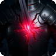
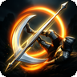
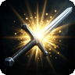
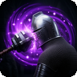
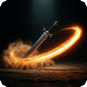
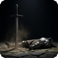

# Fighter Class Guide

**Version:** 0.3.6

The Fighter is a Strength-based martial class with no spells. They compensate with superior action economy — more attacks per turn than any other class, and the ability to surge beyond their normal action limit — and with **martial maneuvers** that trip, stun and confuse enemies, then punish the opening. No energy to manage: maneuvers refresh every battle.

---

## Level Features

These are automatically granted at the listed level.

| Level | Icon | Feature |
|-------|------|---------|
| 1 |  | Renewed Life (Second Wind) |
| 2 |  | Burst of Speed (Action Surge) |
| 3 |  | Exploit Opening |
| 5 |  | Extra Attack (+1) |
| 11 |  | Extra Attack (+2 total) |
| 17 |  | Burst of Speed upgrade |
| 20 |  | Extra Attack (+3 total) |

###  Renewed Life *(L1 — No energy, self-target)*
Draw on reserves of stamina to heal yourself. Healing is **Nd10** where N = `max(1, level / 4)`. No energy cost; **twice per rest**. Also castable from the camp action bar.

###  Burst of Speed *(L2 — No energy, self-target)*
Grants yourself the **Action Surge** condition, giving **2 additional actions** on your next turn. No energy cost; **once per battle** — it refreshes at the start of every encounter, so there is no reason to hoard it between fights.

###  Exploit Opening *(L3)*
Passive. Weapon hits against a target that is **Prone, Stunned, Confused, Staggered, Paralyzed, Ensnared or Asleep** deal **+1d8 physical** damage (**2d8** from Fighter level 13). Works with every weapon attack, not just maneuvers — knock a foe down, then pile on. Fighters who were already past level 3 when this was added receive it at their next level-up.

###  Extra Attack *(L5)*
Passive. Grants **1 extra attack** per turn.

###  Extra Attack *(L11)*
Passive. Upgraded to **2 extra attacks** per turn total.

###  Burst of Speed *(L17 — Upgrade)*
The Action Surge action is upgraded to **twice per battle**.

###  Extra Attack *(L20)*
Passive. Upgraded to **3 extra attacks** per turn total.

---

## Martial Maneuvers

Chosen as the level-up option (one per level, from those unlocked). Each is a weapon attack: roll to hit, deal weapon damage, and on a failed save the target suffers the effect. No energy cost; uses **refresh at the start of every battle**.

**Save DC** = 8 + proficiency bonus + the better of your Strength and Dexterity modifiers. Trips (Trip Attack, Leg Sweep) use **Strength only**.

### Weight and tripping
Every enemy has a body weight. Trips compare it with your **carrying capacity** (Strength score × 15 lb) and adjust the target's save:

| Target weight vs. your capacity | Target's save |
|---|---|
| up to ¼ | −4 |
| up to ½ | −2 |
| up to 1× | +0 |
| up to 2× | +3 |
| up to 4× | +6 |
| over 4× | **cannot be tripped** |

A Strength 16 fighter (240 lb capacity) trips a 170 lb cultist on an even save, a 900 lb Fomorian Beast only rarely (+6), and can't move the 2,000 lb Ammit at all. Raise Strength to topple bigger things. Foes with no legs to sweep or no body to topple (sea serpents, lamiae, slimes, shades, the rooted Grove Guardian) can't be tripped at any weight. Weight appears on the character sheet.

| Unlocks | Icon | Maneuver | Save | Effect | Uses / battle |
|---------|------|----------|------|--------|---------------|
| L1 |  | Trip Attack | Strength | Prone | 2 (3 from L11) |
| L3 |  | Pommel Strike | Constitution | Stunned (loses next turn) | 1 (2 from L11) |
| L3 |  | Disorienting Blow | Wisdom | Confused, 2 turns | 2 (3 from L11) |
| L5 |  | Cleave | none | Full weapon damage to each enemy in a line of three | 2 (3 from L11) |
| L7 |  | Leg Sweep | Dexterity | Prone, every enemy in the 3x3 around you | 1 (2 from L15) |

###  Trip Attack *(L1)*
Hook the foe's legs out from under them. On a failed **Strength** save, adjusted for weight (above), the target is knocked **Prone**.

###  Pommel Strike *(L3)*
Hilt to the skull. On a failed **Constitution** save the target is **Stunned** and loses its next turn (it may also shake the stun off with a DC 12 Constitution save at the end of its turn).

###  Disorienting Blow *(L3)*
A ringing blow to the head. On a failed **Wisdom** save the target is **Confused** for 2 turns: disadvantage on attack rolls and ability checks (DC 12 Intelligence save each turn to recover).

###  Cleave *(L5)*
One great swing through a **line of three squares**, either the three in front of you or the three behind (you pick the side). Rolls to hit each enemy in the line separately; each one hit takes **full** weapon damage. No saving throw and no condition: it is pure damage.

###  Leg Sweep *(L7)*
A wide, low sweep through the **3x3 area centred on you** (every square next to you). Rolls to hit each enemy there separately; each one hit takes **half** weapon damage and, on a failed **Dexterity** save (adjusted for weight), is knocked **Prone**.

###  Prone (condition)
Knocked to the ground through its next turn: **disadvantage on its attack rolls**, and **all attacks against it have advantage**.

## Feat Levels

Generic feats are available at levels **4, 8, 12, and 16**.

- **Great Weapon Master** (level 4): while wielding a *Massive* weapon (Fragarach, the
  Scepter of Divine Ruin), every hit deals **+10 physical damage**, and **landing a
  critical hit grants an extra action that same turn** — the turn extends on the spot,
  and several crits in one turn stack. No effect with any other weapon.

---

## Extra Attacks by Level

| Level | Extra Attacks |
|-------|--------------|
| 1–4 | 0 |
| 5–10 | +1 |
| 11–19 | +2 |
| 20 | +3 |

---

## Tips

- **Strength is your only stat.** Every point of Strength modifier directly increases damage with melee weapons — and raises how heavy a foe you can trip.
- **Burst of Speed** (Action Surge) is a massive burst turn — you effectively double your actions. It recharges every battle, so spend it in *every* fight; save it only for the right turn within the fight, ideally early while there are still several enemies to spend the extra actions on.
- **Renewed Life** is your only recovery tool. Use it proactively when you drop below ~40% HP, not as a last resort when you're near death.
- The Fighter has the **best action economy** in the game at level 20 with 3 extra attacks. In the late game, you can outright kill enemies in a single turn with a strong weapon.
- **Open, then punish.** Trip or stun the most dangerous enemy first, then hit it with everything: advantage from Prone plus Exploit Opening's bonus die stack on every swing — yours and your allies'.
- **Cleave** wants enemies lined up: step so two or three foes stand in the column in front of (or behind) you, then swing. Full damage on every hit makes it your best multi-target damage.
- **Leg Sweep** shines when you are surrounded: step into the middle of a group, and everyone next to you knocked Prone gives the entire party advantage for a turn.
- Spend your maneuvers every fight. They refresh at the start of each battle, so hoarding them gains nothing.
- The Fighter pairs well with high-damage weapons — there are no energy gates on your attacks, so you can go all-out every turn without resource management.
