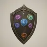
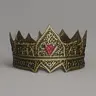
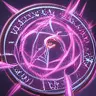

# Sorcerer Class Guide

**Versions:** every feature is tagged with the first game version it shipped in. *0.3.6+* means it was already in 0.3.6 or earlier.

The Sorcerer is a charisma-based spellcaster who draws on innate magic tied to their blood. Their power scales with Charisma, and they unlock affinity-specific abilities based on their character's chosen affinities (Lust, Chaos, or Heavenfire).

---

## Level Features

These are automatically granted at the listed level.

| Level | Icon | Feature | Since |
|-------|------|---------|-------|
| 1 |  | Font of Magic | 0.3.6+ |
| 2 |  | Spell Sniper | 0.3.6+ |
| 3 |  | Metamagic: Empowered | 0.3.6+ |
| 5 |  | Spell Sniper Mastery | 0.3.6+ |
| 7 |  | Arcane Deflection | 0.3.6+ |
| 9 |  | Empowered Spells | 0.3.6+ |
| 11 |  | Sorcerous Resilience | 0.3.6+ |
| 14 |  | Extra Attack | 0.3.6+ |
| 18 |  | Arcane Supremacy | 0.3.6+ |
| 20 |  | Sorcerous Origin | 0.3.6+ |

###  Font of Magic *(L1 — Ability, once per rest · 0.3.6+)*
Draw upon the magic in your blood to recover energy. Recovers **1d4 + Charisma modifier** energy to a randomly selected affinity pool (Lust, Chaos, or Heavenfire). Resets on rest.

###  Spell Sniper *(L2 · 0.3.6+)*
Passive. Extends spell range and improves spell accuracy.

###  Metamagic: Empowered *(L3 · 0.3.6+)*
Passive. Damage dice that roll 1 or 2 are automatically rerolled. Applies to all spell damage.

###  Spell Sniper Mastery *(L5 · 0.3.6+)*
Passive. An upgraded form of Spell Sniper granting further range and accuracy bonuses.

###  Arcane Deflection *(L7 · 0.3.6+)*
Passive. Grants **+2 to saving throws** against enemy spells.

###  Empowered Spells *(L9 · 0.3.6+)*
Passive. Adds your **Charisma modifier** as a bonus to all spell damage rolls.

###  Sorcerous Resilience *(L11 · 0.3.6+)*
Passive. Grants damage resistance based on your active affinities:
- **Lust** → Cold resistance
- **Chaos** → Radiation resistance
- **Heavenfire** → Heat resistance

###  Extra Attack *(L14 · 0.3.6+)*
Passive. Grants one additional attack per turn.

###  Arcane Supremacy *(L18 · 0.3.6+)*
Passive. Permanently increases **Charisma by 4**, with an ability score cap of 24.

###  Sorcerous Origin *(L20 · 0.3.6+)*
Passive. Reduces all spell energy costs by **10%**.

---

## Spells (Level Options)

Spells are chosen on level up and added to your action list.

### Level 1
| Icon | Spell | Energy | Description | Since |
|------|-------|--------|-------------|-------|
|  | Firebolt | 1 | Standard fire damage spell. | 0.3.6+ |
|  | Frost Breath | 1 | Cold damage cone attack. | 0.3.6+ |

### Level 2
| Icon | Spell | Energy | Description | Since |
|------|-------|--------|-------------|-------|
|  | Chaos Bolt | 1 | Roll 2d8 + Charisma. The higher die sets the damage type. If both dice match, the bolt **leaps to a second enemy**. | 0.3.6+ |
|  | Heat | 2 | Kindles magical warmth in a target. Constitution save or become **Hot**: 1d5 heat damage per turn for 5 turns. | 0.3.6+ |

### Level 3
| Icon | Spell | Energy | Description | Since |
|------|-------|--------|-------------|-------|
|  | Command | 1 | A spell that issues a magical command to an enemy. | 0.3.6+ |
|  | Glacial Strike | 2 | Channel cold through your weapon: weapon + scaling cold damage (1d10, +1d10 at L5/11/17). Failed enemy Con save grants you **Glacial Shield**. Melee weapon only *(0.6.1+)*. | 0.3.6+ |

### Level 5
| Icon | Spell | Energy | Description | Since |
|------|-------|--------|-------------|-------|
|  | Fireball | 3 | Large area fire damage. | 0.3.6+ |
|  | Web Barrage | 2 | Ensnares enemies. | 0.3.6+ |
|  | Chain Lightning | 5 | Arcs to all enemies. Primary target takes **10d6** electric damage; others take **5d6**. Dexterity save for half. | 0.3.6+ |
|  | Sleet Storm | 4 | AoE control: all enemies gain **Icy** + **Wet** for 5 turns. Icy = 30% chance to slip and lose a turn; Wet doubles Cold/Lightning damage taken. | 0.3.6+ |

### Level 9
| Icon | Spell | Energy | Description | Since |
|------|-------|--------|-------------|-------|
|  | Blizzard | 8 | AoE nuke: **8d8** cold damage to all enemies (Constitution save for half; scales +1d8 per 3 levels past 9). Those who fail are left **Icy** for 3 turns. Devastating after Sleet Storm's Wet. | 0.3.12+ |

---

## Affinity Infusions *(L6+ — Affinity-Gated)*

Unlocked at level 6 if your character has the matching affinity.

### Heavenfire Affinity *(0.3.6+)*
| Icon | Feature | Description | Since |
|------|---------|-------------|-------|
|  | Sorcerous Radiance | Your spells carry divine light. Deals an extra **1d6 radiation damage** per spell hit (upgrades to **2d6** at level 14+). | 0.3.6+ |

### Lust Affinity *(0.3.6+)*
| Icon | Feature | Description | Since |
|------|---------|-------------|-------|
|  | Sorcerous Charm | Your spells carry seductive power. Spell hits have a chance to inflict **Horny** on targets (Charisma save to resist, DC 8 + Cha mod + L/4). | 0.3.6+ |

### Chaos Affinity *(0.3.6+)*
| Icon | Feature | Description | Since |
|------|---------|-------------|-------|
|  | Sorcerous Wild Magic | Chaos surges through your spells. After casting, **25% chance** for a random bonus effect: extra damage, self-heal, or enemy debuff. | 0.3.6+ |

---

## Affinity Mastery *(L14+ — Affinity-Gated)*

Upgraded affinity abilities, also chosen as level options at level 14+.

### Heavenfire Affinity *(0.3.6+)*
| Icon | Feature | Description | Since |
|------|---------|-------------|-------|
|  | Sorcerous Divine Conduit | Spells that deal damage **heal you for 25%** of damage dealt. | 0.3.6+ |

### Lust Affinity *(0.3.6+)*
| Icon | Feature | Description | Since |
|------|---------|-------------|-------|
|  | Sorcerous Enthrall | Spell targets must make a **Wisdom save or be Stunned** for 1 turn. | 0.3.6+ |

### Chaos Affinity *(0.3.6+)*
| Icon | Feature | Description | Since |
|------|---------|-------------|-------|
|  | Sorcerous Wild Surge | After casting, **50% chance** for a powerful random bonus effect (upgraded from Wild Magic's 25%). | 0.3.6+ |

---

## The Horny Condition (Lust Affinity Mechanic)

When a target is inflicted with **Horny**, they enter a multi-turn battle of lust:

### Horny Mechanics:
- **Disadvantage on attack rolls** — Overwhelming distraction
- **+1 Lust energy per turn** — Passive lust energy recovery (benefits enemies too!)
- **-1 to Wisdom checks and saving throws per Horny level** — lust clouds judgement
- **Wisdom saving throw each turn** — DC 10 + horny_level, made with that penalty. Success reduces horny_level by 1, so a deep Horny is much harder to shake than a light one.
- **Horny level stacks** — Reapplying Horny increases the level instead of resetting it

### Masturbate (Forced Action at Low Horny Levels) *(0.3.6+)*
When horny, the target has a chance each turn to be forced to **Masturbate** (becomes their action):
- **Grants 1d3 lust energy** to the affected character
- No energy cost
- Chance **increases** with horny level: 1/5 at level 1, 1/4 at level 2, 1/3 at level 3, 1/2 at level 4
- Also makes a Charisma-based saving throw (DC 8 + Cha mod + L/4) against **all enemies** — failures inflict Horny on them

### Orgasm (Forced Action at Horny Level 5+) *(0.3.6+)*
When horny_level reaches **5+**, the target is **forced to Orgasm** instead of their normal action:
- **Restores 2-5 lust energy** for the affected character
- **Restores 5-10 lust energy** for ALL allies and enemies nearby
- **Removes Horny** from the affected character
- **Inflicts Post Nut Clarity** on the affected character
- **50% chance to inflict Wet** on a random nearby character

### Post Nut Clarity (Condition) *(0.3.6+)*
After Orgasm, the affected character gains Post Nut Clarity:
- **Disadvantage on Constitution checks**
- **Advantage on Intelligence checks**
- **Permanent until rest** — doesn't clear between turns
- Clears naturally when resting

---

## Feat Levels

Generic feats are available at levels **4, 8, 12, and 16**.

---

## Tips

- **Charisma is everything.** Attack rolls, damage bonuses (L9), and energy recovery (Font of Magic) all scale with Charisma. Stack it.
- **Font of Magic** is your energy lifeline in long fights — use it early if you need spell resources.
- **Chaos Bolt** is deceptively strong: the random damage type can bypass resistances, and matching dice trigger a free bounce for double the damage.
- **Chain Lightning** (L5) is your best multi-enemy nuke at 5 energy — save it for grouped enemies.
- **Affinity choices matter.** Pick your affinity infusion (L6) and mastery (L14) based on your playstyle: Heavenfire for sustained damage/lifesteal, Lust for crowd control and lust energy generation, Chaos for high-variance burst.
- **Sorcerous Charm stacking** (L6 Lust) is powerful — stack Horny high enough and enemies are forced to Orgasm, restoring energy for the whole battlefield. Use it when you need to disrupt enemy actions and gain lust energy.
- **Post Nut Clarity is a setup tool** — After an Orgasm, affected enemies have disadvantage on Constitution checks, making them vulnerable to crowd control. Exploit this window.
- **Metamagic: Empowered** (L3) quietly improves every spell you cast for the rest of the game — its reroll effect prevents wasted low dice rolls.
